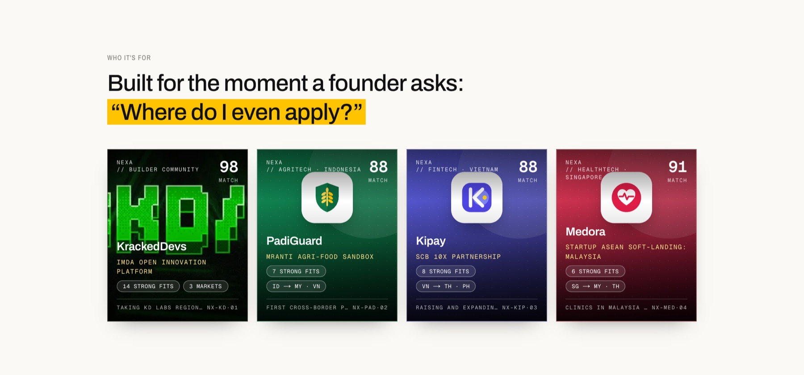
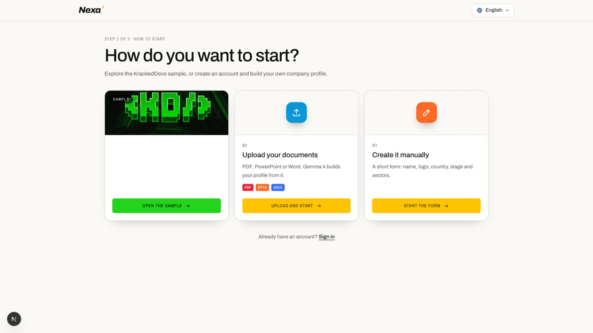
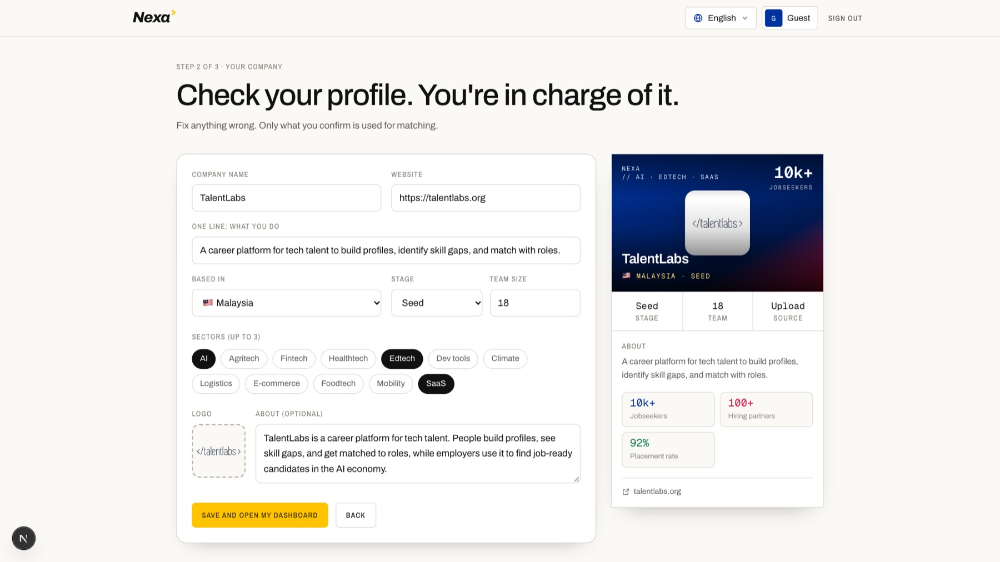
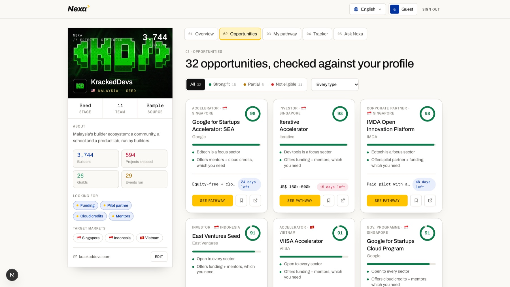
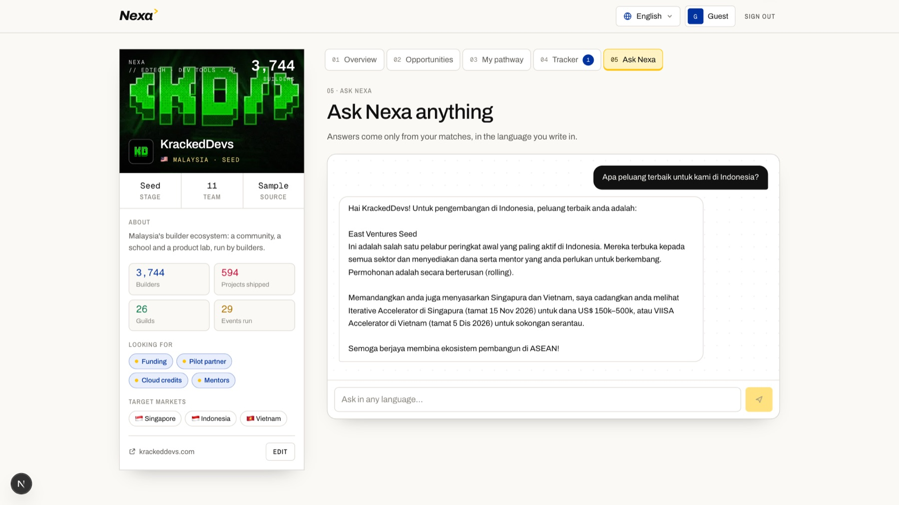
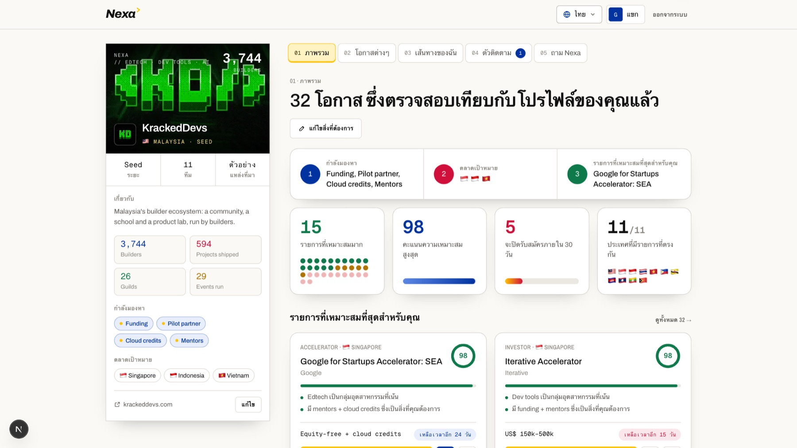
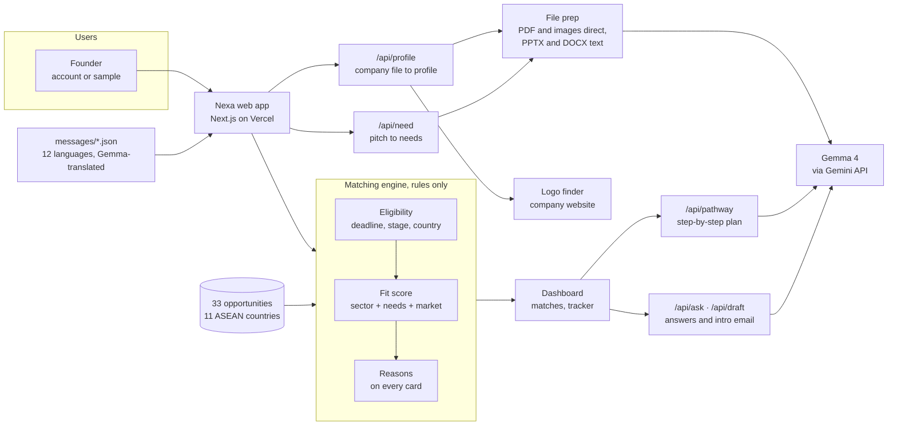

#  Nexa

Eleven countries. One door.

**Nexa reads a startup once, then finds the grants, investors, programmes and
partners across all 11 ASEAN countries that it actually qualifies for, with a
step-by-step pathway to each one, in 12 languages.**




*One door for every founder. KrackedDevs, PadiGuard, Kipay and Medora each get
their best-fit opportunity, scored by rules that anyone can check.*

---

## 📋 Team Information

| Field | Details |
|---|---|
| **Team Name** | Nexa |
| **Hackathon** | Hacktoberfest Hack Day Kuala Lumpur · 31 Oct 2026 · DOJO Coworking KL |
| **Challenge** | Startup ASEAN · Problem Statement 2: Ecosystem Gateway |
| **Prize Categories** | Best Use of Gemma 4 · Best Open-Source AI Project |
| **Team Leader** | *To be added* |
| **Number of Members** | *To be added* |

## 🔗 Links

| Resource | Link |
|---|---|
| 💻 **GitHub Repository** | **[github.com/eyahia1712/Nexa-Hacktober](https://github.com/eyahia1712/Nexa-Hacktober)** |
| 🎬 **Demo Video** | *To be added* |
| 🌐 **Live Demo** | *To be added* |
| 📄 **Sample files to upload** | [TalentLabs company profile (PDF)](public/samples/talentlabs-company-profile.pdf) · [KrackedDevs "what we need" brief (PDF)](public/samples/krackeddevs-what-we-need.pdf) |

---

## 💡 Overview

### Problem

ASEAN has the money, the programmes and the partners. Founders just can't find
the ones that fit them.

- **The connections already exist.** Startup ASEAN has connected about 11,000
  startups with 5,000 investors (Startup ASEAN / Cradle, 2025, self-reported).
- **The region is split eleven ways.** 11 member states, including Timor-Leste
  since October 2025, and so 11 portals, 11 rulebooks and more than 10 languages.
- **Founders rarely build across borders.** Only about 15% of Singapore's
  foreign-born unicorn founders come from elsewhere in ASEAN (Nikkei Asia, via
  KR-Asia).
- **The same barriers keep coming back:** different rules per country, hard
  market entry, partner mismatch and funding gaps (ERIA–ATLAS white paper).

**A founder with a good product still asks one question: "Where do I even apply?"**

### Solution

#### 🚪 1. Start in seconds

- Three ways in: the **KrackedDevs sample profile**, **upload your company
  documents**, or **fill in a short form** with your logo
- **Gemma 4 reads PDF, PowerPoint and Word**, and builds the profile: country,
  stage, sectors, team, key numbers
- Nexa finds the **company logo** from the website named in the document
- The founder checks and edits every field before anything is matched

**Upload a company profile, get a company card.**

---

#### 🎯 2. Say what you need

- Upload a pitch or funding brief, and **Gemma 4 picks out the needs** (funding,
  pilot partner, market entry, talent, mentors, cloud credits) and the **target
  markets**
- Or pick them by hand: needs, target countries, your ask

**The dashboard opens only when Nexa knows what you are looking for.**

---

#### 🌏 3. Matches in all 11 countries

- **33 opportunities** across all 11 ASEAN member states: grants, investors,
  accelerators, corporate partners and government programmes
- **Fixed rules decide eligibility, never the AI.** Deadline passed, wrong stage
  or not open to your country means not eligible
- The fit score adds up in plain sight: sector + needs + target market
- **Every card shows its reasons**

**No black box. Every match explains itself.**

---

#### 🛣️ 4. A pathway for each opportunity

- Pick an opportunity and **Gemma 4 plans the route**: 4 to 5 steps up to the
  deadline, the documents to prepare, and one insider tip
- **One-click intro email**, written for that exact programme or investor
- Without an API key, the same pathway comes from plain rules

**From "this fits" to "here is what I do this week".**

---

#### 📊 5. Track it and ask anything

- A **deal tracker** from saved to applied, meeting and deal, with conversion at
  each step
- **Ask Nexa**: questions answered only from your matches, in the language you
  write in

**Every saved, applied and signed deal is a signal Startup ASEAN can use.**

---

#### 🗣️ 6. In your language

- **12 languages**: English, Bahasa Melayu, Bahasa Indonesia, 中文, தமிழ், ไทย,
  Tiếng Việt, Filipino, ខ្មែរ, ລາວ, မြန်မာ and Tetun
- The whole interface was translated by **Gemma 4**, and pathways, emails and
  answers come out in the chosen language

**Eleven countries, and nobody left out by language.**

### Key Features

- **Three-way intake**: sample profile, document upload (PDF / PPTX / DOCX / image) or manual form with logo
- **Profile from documents**: Gemma 4 reads the file; the logo comes from the company website
- **Needs from a pitch**: Gemma 4 turns a brief into needs, markets and an ask
- **Rules-based matching**: 33 opportunities, 11 countries, eligibility checks and a visible score
- **Pathway and intro email**: Gemma 4, in the chosen language, with a rules fallback
- **Deal tracker**: saved → applied → meeting → deal
- **Ask Nexa**: multilingual answers grounded only in the company's matches
- **12-language interface**: a dropdown at the top of every page
- **Accounts**: create an account or sign in; judges can open the sample with no account



*Three ways to start. The KrackedDevs sample needs no account.*



*Upload the TalentLabs PDF: Gemma 4 fills in the profile and Nexa finds the logo.*


*The dashboard: the company card on the left, and on the right what they need,
strong fits, the best score, deadlines and countries with a match.*



*Every opportunity is a card with its score, the reasons, the amount and the deadline.*


*A step-by-step route, the documents to prepare and a tip, planned by Gemma 4.*



*Ask in Bahasa Indonesia, get the answer in Bahasa Indonesia.*



*The same dashboard in Thai. One click in the language menu.*

### Tech Stack

| Layer | Technology | Why |
|---|---|---|
| Frontend | Next.js 16, React 19, Tailwind CSS 4, TypeScript | One fast, mobile-friendly app |
| Backend | Next.js route handlers | `/api/profile`, `/api/need`, `/api/pathway`, `/api/ask`, `/api/draft` |
| AI | **Gemma 4** (`gemma-4-26b-a4b-it`) through the Gemini API | Open-weight, multimodal: reads PDFs and images directly |
| File reading | `fflate` for PowerPoint and Word text, in memory | Nothing uploaded is stored |
| Data | Typed opportunity dataset (33 entries, 11 countries) | Real organisation names; illustrative amounts and dates |
| Storage | Browser localStorage | Demo accounts, profiles and tracker stay on the device |
| Translation | Gemma 4 at build time (`scripts/translate.mjs`) | 12 languages, only missing keys are re-translated |
| Hosting / Dev | Vercel · GitHub | Zero-setup deployment |

**Sources:** Startup ASEAN / Cradle, ASEAN Secretariat, ERIA, Nikkei Asia,
krackeddevs.com and talentlabs.org. Every source is linked on the landing page.

---

## 📁 Project Structure

```
.
├── app/                      # Pages: / · /login · /start · /dashboard
│   └── api/                  # profile · need · pathway · ask · draft
├── components/
│   ├── landing/              # Hero, problem, who it's for, how it works
│   ├── CompanyCard.tsx       # The profile card on the left
│   ├── AppHeader.tsx         # Logo, language menu, account
│   └── ui.tsx                # Buttons, language menu, score ring, modal
├── lib/
│   ├── gemma.ts              # Gemma 4 calls, prompts and output cleaning
│   ├── match.ts              # Eligibility rules and fit score
│   ├── opportunities.ts      # 33 opportunities across 11 countries
│   ├── extract.ts            # PDF / image / PPTX / DOCX preparation
│   ├── logo.ts               # Company logo from its website
│   ├── i18n.tsx              # Language provider for 12 languages
│   ├── samples.ts            # KrackedDevs and landing-page samples
│   └── store.ts              # Browser accounts, profiles and tracker
├── messages/                 # en.json plus 11 Gemma-translated languages
├── public/
│   ├── kd/                   # KrackedDevs logo and banner
│   └── samples/              # Sample PDFs to upload
├── scripts/translate.mjs     # Gemma 4 translation script
├── docs/screenshots/         # README images
├── .env.example              # Example environment variables
├── LICENSE
├── package.json
└── README.md
```

### Architecture



- **Rules decide, Gemma explains** (`lib/match.ts`): eligibility and scores are
  plain TypeScript. The same input always gives the same answer, and Gemma never
  decides who qualifies.
- **Gemma 4 reads and writes** (`lib/gemma.ts`): documents to profiles, pitches
  to needs, matches to pathways, emails and answers, all in the chosen language.
- **Every answer is checked** before use: model output is parsed and limited to
  the allowed countries, stages, sectors and needs.
- **Works without a key**: sample answers and a rules-based pathway keep the
  whole flow running.

---

## 🚀 How to Run

### Run Locally

```bash
git clone https://github.com/eyahia1712/Nexa-Hacktober.git
cd Nexa-Hacktober
npm install                  # Node.js 20+
cp .env.example .env.local   # add GEMINI_API_KEY; Nexa also runs without it
npm run dev                  # http://localhost:3000
```

### Try It

1. Open http://localhost:3000 and click **See my opportunities**.
2. Choose **Sample profile** to open KrackedDevs, then upload
   [`krackeddevs-what-we-need.pdf`](public/samples/krackeddevs-what-we-need.pdf)
   or click **Use KD's sample pitch**.
3. Or choose **Upload your documents** and upload
   [`talentlabs-company-profile.pdf`](public/samples/talentlabs-company-profile.pdf).

### Translate New Text

```bash
node --env-file=.env.local scripts/translate.mjs
```

### Type Check

```bash
npm run typecheck
```

---

## 🧗 Challenges & Learnings

- **AI that can't invent opportunities.** We kept eligibility in plain rules
  and let Gemma 4 only read, explain and write. Every match lists its reasons.
- **PowerPoint isn't a Gemini input.** PDFs and images go to Gemma 4 directly;
  for PPTX and DOCX we pull the text out in memory first.
- **Twelve languages in one day.** Gemma 4 translated the interface at build
  time, and generated content follows the chosen language.
- **Model load on demo day.** Gemma sometimes returned 500 or 503 under load, so
  calls retry once and the pathway falls back to rules.

## 🔭 Future Improvements

- [ ] Live opportunity feeds from Startup ASEAN, Cradle and national agencies
- [ ] Real accounts and a shared deal pipeline for Startup ASEAN programme teams
- [ ] Import an opportunity from a poster or a social post with Gemma 4
- [ ] Alerts when a new opportunity matches a saved profile
- [ ] A Startup ASEAN view: where founders drop off, and which programmes turn
  connections into deals

## 👥 Team

| Name | Role |
|---|---|
| *To be added* | *To be added* |
| *To be added* | *To be added* |
| *To be added* | *To be added* |
| *To be added* | *To be added* |

---

## ✅ Submission Checklist

**MLH OrganizerHQ submission (closes 31 Oct 2026, 3:00 PM)**

- [x] Project name: Nexa
- [x] Source code: GitHub repository
- [x] Description
- [x] Technologies used: Next.js, React, TypeScript, Tailwind CSS, Gemma 4 (Gemini API)
- [x] AI the project calls: Gemma, Gemini
- [ ] Live demo / video link
- [x] Prize categories: Best Use of Gemma 4 · Best Open-Source AI Project
- [x] AI coding tools: Claude Code

**Repository**

- [x] "How to Run" steps verified
- [x] No API keys or secrets committed to the repository
- [x] Open-source license (Apache 2.0)

## 📜 License

This project is licensed under the [Apache License 2.0](LICENSE).

---

*Nexa · Team Nexa · Hacktoberfest Hack Day Kuala Lumpur 2026*
